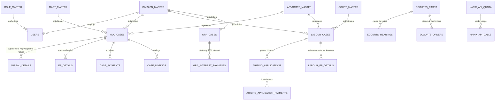

# 💾 Law Project — Database Schema & Data Dictionary

> **Database Engine**: Microsoft SQL Server (2019+ / Express / LocalDB)  
> **Master Schema File**: [`Law Project/CaseManagement/SQL/00_Master_Full_Database_Schema_And_Seed.sql`](file:///c:/Users/adts-/Desktop/Law%20Project/Law%20Project/CaseManagement/SQL/00_Master_Full_Database_Schema_And_Seed.sql)  
> **Total Tables**: 83 Tables | 55 Historical Migrations Consolidated

---

## 📌 1. Database Architecture & ERD Overview

---

## 🏛️ 2. Core Functional Domain Tables

### 2.1 Motor Vehicle Claims (`tbl_MVC_Cases` & Sub-tables)
- **`tbl_MVC_Cases`**: The primary registry for MACT claims.
  - `CaseID` (PK, INT IDENTITY)
  - `CaseNo`, `CaseYear`, `CNR`, `DivisionID` (FK)
  - `MACTCourtID` (FK to `tbl_MACT_Master`), `CourtCity`
  - `AccidentDate`, `VehicleNo`, `DriverName`, `DriverStaffNo`, `Route`
  - `ClaimAmount`, `AwardAmount`, `LiabilityPercentCorp`, `InterestRate`
  - `CaseStatus` (Pending, Disposed, Transferred), `DisposalDate`, `DisposalNature`
- **`tbl_Appeal_Details`**: High Court (MFA/WP) and Supreme Court (SLP) appeal records.
  - `AppealID` (PK), `CaseID` (FK), `AppealType` (Claimant / Corporation)
  - `AppealNumber`, `AppealYear`, `CourtBench` (Bengaluru, Dharwad, Kalaburagi)
  - `AdvocateID` (FK), `FilingDate`, `LimitationExpiryDate`
  - `StayGranted` (BIT), `StayExpiryDate`, `InterimCompensationAmount`
  - `DisposalDate`, `AppealResult`
- **`tbl_EP_Details`**: Execution Petitions filed for award recovery.
  - `EPID` (PK), `CaseID` (FK), `EPNumber`, `EPYear`
  - `AttachmentNoticeDate`, `RecoveryAmount`, `BankDepositDate`, `DepositAmount`
- **`tbl_Case_Payments`**: Itemized accounting vouchers and financial disbursements.
- **`tbl_Case_Notings`**: Internal file notings and procedural records.

---

### 2.2 Labour Disputes & Arising Applications (`tbl_Labour_Cases` & Sub-tables)
- **`tbl_Labour_Cases`**: Industrial Disputes (ID), Section 33-C(2) claims, and Service Matters.
  - `LabourID` (PK, INT IDENTITY)
  - `CaseNumber`, `CaseYear`, `CNR`, `DivisionID` (FK), `DepotID` (FK)
  - `ApplicantName`, `TokenNo`, `Designation`, `AdvocateID` (FK)
  - `DisputeSubject`, `SectionAct` (e.g., ID Act Sec 10, Sec 33-C(2))
  - `AwardDate`, `AwardNature` (Reinstatement with continuity, back-wages, dismissed)
  - `CO_ActionTaken`, `CO_Disposal_Decision`, `CO_ApprovalDate`, `CO_Remarks`
- **`tbl_Arising_Applications`**: Interlocutory & monetary computation claims arising from parent disputes.
  - `ArisingID` (PK, INT IDENTITY)
  - `CaseNumber`, `CaseYear`, `CNR`, `DivisionID` (FK)
  - `ParentCaseID` (FK to `tbl_Labour_Cases`), `ParentCaseNumber`, `ParentAwardSummary`
  - `PetitionerName`, `PetitionerDesignation`, `DepotID`
  - `ClaimDetails`, `ApplicationDate`, `AwardAmount`, `TotalPaidAmount`, `RemainingBalance`
  - `Opinion_Advocate`, `Opinion_LO`, `ActionTaken_LO`, `ApprovalDate_LO`
  - `Opinion_DyCLO`, `ActionTaken_DyCLO`, `ApprovalDate_DyCLO`
  - `Opinion_CLO`, `ActionTaken_CLO`, `ApprovalDate_CLO`
  - `Opinion_MD`, `ActionTaken_MD`, `ApprovalDate_MD`
  - `Opinion_DC`, `CO_OutwardNo`, `CO_OutwardDate`
- **`tbl_Arising_Application_Payments`**: Itemized disbursement installments against arising claims.
  - `PaymentID` (PK), `ArisingID` (FK), `InstallmentNumber`, `PaidAmount`, `PaymentDate`, `VoucherNumber`, `BankReference`
- **`tbl_Labour_EP_Details`**: Execution Petitions for Labour Court awards (reinstatement, back-wages).

---

### 2.3 Payment of Gratuity Act (`tbl_Gra_Cases` & Sub-tables)
- **`tbl_Gra_Cases`**: Controlling Authority (CA) & Appellate Authority (AA) gratuity disputes.
  - `GraID` (PK, INT IDENTITY)
  - `ApplicationNo`, `ApplicationYear`, `DivisionID` (FK)
  - `EmployeeName`, `StaffNo`, `Designation`, `DateOfRetirement`
  - `LastDrawnWages`, `LengthOfService`, `ClaimedGratuityAmount`
  - `DeterminedGratuityAmount`, `DelayDays`, `StatutoryInterestAmount`
  - `StatutoryDepositDate`, `DepositAmount`, `AppellateAuthorityOutcome`
- **`tbl_Gra_Interest_Payments`**: Computations and vouchers for 10% statutory delayed interest.

---

### 2.4 e-Courts & NAPIX Gateway Infrastructure
- **`tbl_ECourts_Cases`**: Synced repository of official court case records.
  - `ECourtsCaseID` (PK), `CNR` (16-char unique), `CaseType`, `CaseNumber`, `CaseYear`
  - `CourtCode`, `StateCode`, `DistrictCode`, `CourtHallNumber`
  - `Petitioner`, `Respondent`, `PetitionerAdvocate`, `RespondentAdvocate`
  - `CaseStage`, `NextHearingDate`, `CourtStatus`, `LastSyncedTimestamp`
- **`tbl_ECourts_Hearings`**: Cause list hearing history and proceedings notes.
- **`tbl_ECourts_Orders`**: Order sheets, interim stay orders, and judgment PDF paths.
- **`tbl_Napix_Api_Quota`**: Real-time hourly quota budgeting (1000 calls/hour per module).
  - `QuotaID` (PK), `Module` (MVC, Labour, OtherCourts), `HourWindowStart`, `CallsConsumed`, `CallsRemaining`
- **`tbl_Napix_Api_Calls`**: Detailed audit log of every outbound request to NIC gateway.

---

### 2.5 Security, Master Data & Audit Tables
- **`tbl_Users`**: User credentials, claims, contact numbers for SMS alerts.
  - `UserID` (PK), `Username`, `PasswordHash` (PBKDF2), `FullName`, `Email`, `MobileNo`, `RoleID` (FK), `DivisionID` (FK), `IsActive`
- **`tbl_Role_Master`**: System security roles (Admin, DivisionUser, CentralOffice, Advocate, LO, DyCLO, CLO, MD).
- **`tbl_Division_Master`**: Corporate divisions (Central Office, Belagavi, Hubballi, Dharwad, Gadag, Bagalkot, Vijayapura, Uttara Kannada, Haveri, Chikodi).
- **`tbl_MACT_Master`**: Motor Accident Claims Tribunals.
- **`tbl_Court_Master`**: High Court benches, District Courts, Labour Courts, Industrial Tribunals.
- **`tbl_Advocate_Master`**: Panel advocates, contact info, division empanelment.
- **`tbl_Case_Activity_Logs`**: Comprehensive chronological audit trail.
- **`tbl_NyayaPatha_Audit`**: AI search queries, token consumption, response timestamps, citation audits.

---

## ⚡ 3. Key Stored Procedures

1. **`sp_SaveAppealFull`**: Atomic stored procedure saving or updating high court appeal details, stay applications, and interim deposits in a single ACID transaction.
2. **`sp_GetDashboardStats`**: High-performance dashboard aggregation computing statewide and division-wise totals for active, pending, disposed, and appealed claims.
3. **`sp_UpdateECourtsCaseStatus`**: Atomic update routine synchronizing eCourts NAPIX payload data into local case tables.

---

## 🔄 4. Dynamic Migration Engine

The solution manages schema evolution dynamically via [`DatabaseMigrationRunner.cs`](file:///c:/Users/adts-/Desktop/Law%20Project/Law%20Project/CaseManagement/DAL/DatabaseMigrationRunner.cs) and [`DBMigration.cs`](file:///c:/Users/adts-/Desktop/Law%20Project/Law%20Project/CaseManagement/DAL/DBMigration.cs):

- Automatically queries `INFORMATION_SCHEMA.COLUMNS` and `sys.indexes` on application startup.
- Idempotently executes `ALTER TABLE ADD ...` or creates missing non-clustered indexes if not present.
- Guarantees zero-downtime updates across developer environments and production IIS instances.
