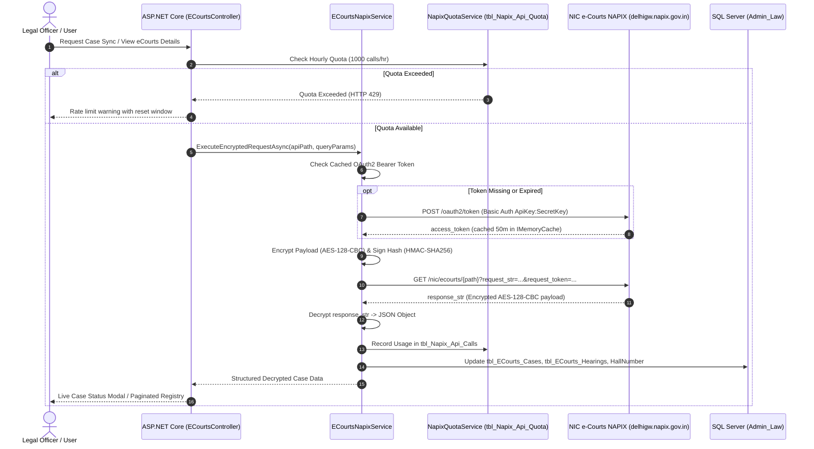

# 🌐 e-Courts NAPIX API Gateway & Integration Specification

> **Gateway Infrastructure**: National Informatics Centre (NIC) e-Courts NAPIX Platform v1.3  
> **Supported Courts**: District Courts / ICJS (19 APIs) & High Courts (22 APIs)  
> **C# Service Implementation**: [`ECourtsNapixService.cs`](file:///c:/Users/adts-/Desktop/Law%20Project/Law%20Project/CaseManagement/Utils/ECourtsNapixService.cs)  
> **Sync Engine**: [`NapixSyncEngine.cs`](file:///c:/Users/adts-/Desktop/Law%20Project/Law%20Project/CaseManagement/Utils/NapixSyncEngine.cs)  
> **Client Controller**: [`ECourtsController.cs`](file:///c:/Users/adts-/Desktop/Law%20Project/Law%20Project/CaseManagement/Controllers/ECourtsController.cs)  
> **Frontend Integration**: [`ecourts-details.js`](file:///c:/Users/adts-/Desktop/Law%20Project/Law%20Project/CaseManagement/wwwroot/js/ecourts-details.js)

---

## 📌 1. Integration Architecture Overview

The **Law Project** integrates directly with the official **Indian e-Courts System** via the **NIC NAPIX Gateway v1.3**. This integration enables automated 16-digit CNR auto-linking, real-time case status lookups, hearing date synchronizations, judgment order views, court hall resolution, and cause list fetches for both District Courts (ICJS) and High Courts.



---

## 🔑 2. Cryptographic Security Protocol

The NAPIX Gateway enforces enterprise security controls requiring OAuth2 bearer authentication, payload encryption, and request signing.

### 2.1 Configuration Keys (`appsettings.json`)
```json
"eCourts": {
  "DeptId": "clonwkrtc",
  "AuthKey": "tD7Ju6n0Cdf4vxUo",
  "HmacKey": "15081947",
  "Version": "v1.0",
  "GatewayUrl": "https://delhigw.napix.gov.in/nic/ecourts",
  "OAuthTokenUrl": "https://delhigw.napix.gov.in/nic/ecourts/oauth2/token",
  "EnableBackgroundSync": true,
  "MVC": {
    "ApiKey": "5763de722863865e2691e137691d4333",
    "SecretKey": "454aba6d3c5c867ae185cd198f572ef8"
  },
  "Labour": {
    "ApiKey": "9b54f1a9420610260bf6fc16b6aea571",
    "SecretKey": "81138f78dc15e93b1381e415f34771c1"
  },
  "OtherCourts": {
    "ApiKey": "e3c53d81c28155569d13699aee22c7e2",
    "SecretKey": "88c225479d6d43d30d59562cb4ff8fef",
    "HourlyQuota": 1000
  }
}
```

### 2.2 Security Execution Flow
1. **OAuth2 Bearer Token**:
   - Transmitted via Basic Authorization header (`Basic Base64(ApiKey:SecretKey)`).
   - Grants `access_token` cached in `IMemoryCache` for 55 minutes (`eCourts_OAuth_Token`).
   - If NAPIX returns `INVALID_TOKEN` or HTTP 401, `ECourtsNapixService` automatically evicts cache, acquires a fresh token, and retries the request seamlessly.
2. **AES-128-CBC Payload Encryption**:
   - Plaintext query parameters (e.g. `est_code=KAUKA01|case_type=MVC|reg_no=123|reg_year=2024`) are encrypted using **AES-128-CBC** with `AuthKey` and `IV`.
   - The encrypted byte array is Base64 encoded and URL-escaped into `request_str`.
3. **HMAC-SHA256 Request Signing**:
   - A cryptographic hash of the plaintext query parameters is generated using **HMAC-SHA256** signed with `HmacKey`.
   - Transmitted in the request query string as `request_token`.
4. **Payload Decryption**:
   - Successful responses return an encrypted string inside `response_str`.
   - `ECourtsNapixService.AesDecrypt()` decrypts `response_str` into structured JSON objects.

---

## 🆔 3. 16-Digit CNR Discovery & Decoding Engine

### 3.1 CNR Structure
An Indian e-Courts CNR (Case Number Record) is a 16-character unique identifier:
$$\text{CNR Format}: \underbrace{\text{KA}}_{\text{State}} \underbrace{\text{UKA}}_{\text{District}} \underbrace{20006722017}_{\text{Establishment, Case Sequence \& Year}}$$

### 3.2 Automated Code Decoding (`DecodeCnrCodes`)
When querying status or orders by CNR, `ECourtsNapixService` automatically extracts state and district parameters:

| CNR Prefix | State Name | State Code (NAPIX / CIS) | District Name | District Code |
| :--- | :--- | :--- | :--- | :--- |
| `KAUKA` | Karnataka | `29` / `6` | Uttara Kannada | `19` |
| `KADW` | Karnataka | `29` / `6` | Dharwad | `1` |
| `KABG` / `KABAG` | Karnataka | `29` / `6` | Bagalkot | `4` |
| `KADVG` / `KADAG` | Karnataka | `29` / `6` | Davanagere | `9` |
| `KAHC` | Karnataka High Court | `29` | High Court Bench | Bench Code |
| `MHBOM` | Maharashtra | `27` | Mumbai | `1` |
| `DL` | Delhi | `7` | Delhi Courts | District Code |

---

## 🏛️ 4. Automated Court Hall Resolution Engine

In high-volume court establishments, hearing notices often omit explicit courtroom designations. The **Hall Resolution Engine** in `ECourtsController` and `ECourtsNapixService`:
1. Scans daily cause list proceedings and establishment master rosters (`CourtJudgeList`).
2. Extracts judge designation, courtroom number, and bench type from raw NAPIX business proceedings.
3. Automatically persists the decoded `HallNumber` into `tbl_ECourts_Cases` and `tbl_MVC_Cases`.
4. Displays the courtroom badge directly on user dashboards and hearing reminder SMS notifications.

---

## 📄 5. MyCases Server-Side Pagination & Real-Time Status

The [`/ECourts/MyCases`](file:///c:/Users/adts-/Desktop/Law%20Project/Law%20Project/CaseManagement/Views/ECourts/MyCases.cshtml) interface provides high-performance server-side pagination:
- **Server-Side SQL Pagination**: Employs `OFFSET @Offset ROWS FETCH NEXT @PageSize ROWS ONLY` preventing client memory saturation over tens of thousands of cases.
- **Multi-Filter Support**: Filter by Division (`DivisionID`), Case Type (`MVC`, `Labour`, `Other`), Court Complex, Date Range, or Search Term (CNR, Case Number, Petitioner/Respondent).
- **Real-Time Status Badges**:
  - `SYNCED`: Live status matches e-Courts records within the last 24 hours.
  - `HEARING_SOON`: Next hearing scheduled within 7 days.
  - `DISPOSED`: Case disposed in court with final order available.
  - `STALE`: Case not synced in > 30 days, one-click manual sync enabled.

---

## ⏱️ 6. Hourly Quota Management (`tbl_Napix_Api_Quota`)

To prevent IP rate-limiting from the National Informatics Centre gateway:
- Every outbound request checks [`NapixQuotaService.cs`](file:///c:/Users/adts-/Desktop/Law%20Project/Law%20Project/CaseManagement/Utils/NapixQuotaService.cs).
- Enforces an hourly cap of **1,000 requests per module window**.
- Tracks consumed calls, remaining allowance, and window resets in real-time.
- If quota reaches 95%, background bulk sync jobs automatically pause and yield bandwidth to interactive user requests.

---

## 📜 7. OpenAPI Endpoints Catalog (41 Endpoints)

Full OpenAPI specifications are maintained in the repository:
- **District Courts / ICJS (19 Endpoints)**: `District Court Status API/` (`ecourt-icjs-cnr-api`, `ecourt-icjs-cause-list-api`, `ecourt-icjs-show-order-api`, etc.).
- **High Courts (22 Endpoints)**: `High Court Case Status API/` (`hc-cnr-api`, `hc-case-search-api`, `hc-order-api`, `hc-causelist-bench-api`, etc.).
