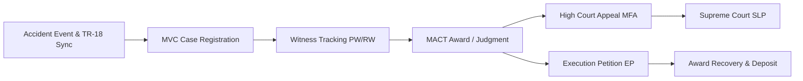

# 📑 Law Project — Modules & Features Operational Guide

> **Enterprise Scope**: Motor Vehicle Claims (MVC/MACT), Labour Court & Service Matters, Arising Applications, Payment of Gratuity Act, Other Courts, Execution Petitions (EP), Petty Bills, Nyaya Patha AI, e-Courts Gateway, and Notification Engine.

---

## 📌 1. Motor Vehicle Claims (MVC / MACT) Module

The **MVC Module** manages legal claims filed against the corporation under the Motor Vehicles Act before Motor Accident Claims Tribunals (MACT).



### 1.1 Core Workflows & Capabilities
- **Case Registration**: Records accident date, vehicle registration number, driver name, staff token, route details, tribunal court (`MACT_MASTER`), claimant particulars, and claimed compensation amount.
- **Witness & Evidence Tracking**: Maintains petitioner witnesses (PW) and respondent witnesses (RW), medical evidence records, cross-examination dates, and adverse remarks.
- **Award & Judgment Recording**: Logs awarded compensation, liability allocation (corporation vs. third party / insurance), interest rates, and tribunal costs.
- **High Court Appeals (MFA)**: Links Miscellaneous First Appeal (MFA) records directly to parent MVC cases. Monitors filing limitation deadlines (90 days), stay order applications, stay expiry dates, and High Court advocate entrustments.
- **Execution Petitions (EP)**: Tracks Execution Petitions filed by claimants for award enforcement. Monitors court attachment warrants, bank deposits, and interim stays.
- **Inter-Division Transfers**: Manages jurisdictional transfers when depot allocations change, maintaining a tamper-evident transfer audit log.

---

## ⚖️ 2. Labour Disputes & Service Matters Module

The **Labour Module** governs Industrial Disputes (ID), Labour Court Applications (LCA), Serial Applications, Direct High Court Service Matters (Writ Petitions - WP), and Interlocutory Arising Applications.

### 2.1 Sub-Modules & Jurisdictions

| Sub-Module | Jurisdiction | Description | Key Attributes |
| :--- | :--- | :--- | :--- |
| **Labour Court Cases** | Labour Court / Industrial Tribunal | Industrial Disputes (ID), Section 33-C(2) LCAs, and disciplinary dismissal disputes. | Applicant Name, Token No, Entrustment No, Section/Act, Award Status. |
| **Service Matters** | High Court (Direct Writs) | Direct Writ Petitions (WP) filed by employees or the corporation against awards. | WP No, High Court Bench, High Court Advocate, Interim Stays, Disposal Result. |
| **Arising Applications** | Labour / Industrial Tribunal | Monetary computation claims (e.g. wage arrears, bonus) arising from primary awards. | Parent Case ID (KID/ID), Application Date, Claim Details, Installment Ledger. |
| **Labour EP Details** | Labour Court | Execution Petitions for employee reinstatement decrees or back-wage execution. | EP No, Compliance Target Date, Back-wage Amount, Deposit Status. |

### 2.2 Arising Applications & Parent Case Linking
- **Parent Cross-Referencing**: Connects an Arising Application to its original parent dispute (e.g. linking Arising App 1/2026 to parent dispute KID/ID 6/2016).
- **Financial & Installment Accounting**: Tracks total claim amount, awarded sum, total paid to date, and remaining balance with an itemized payment installment ledger.
- **Official A4 Legal Dossier & Proforma Report**: Generates a standardized, printable legal dossier formatted for official departmental records:
  - Corporation Letterhead and Telemetry Header
  - Section I: Application Registration & Jurisdiction
  - Section II: Workman Profile & Service Particulars
  - Section III: Linked Primary Labour Case Details
  - Section IV: Legal Representation & Departmental Defence
  - Section V: Case Disposal, Award & Financial Accounting
  - Section VI: Linked Execution Petition (EP) Details
  - Section VII: Higher Court Appeals & Writs (WP/WA/SLP)
  - Section VIII: Multi-Tier Legal Opinions & Executive Decisions
  - Official 3-Tier Authentication & Signature Block (LO $\to$ DC $\to$ CLO/MD)

### 2.3 Corporate Action Approval Workflow (CO / LO / Dy. CLO / CLO / MD)
Every high-stakes Labour dispute and Arising Application moves through a rigorous multi-tier review:

```
[ Panel Advocate Opinion ]
           │
           ▼
[ Law Officer (LO) Review ]
           │
           ▼
[ Dy. Chief Law Officer (Dy. CLO) Scrutiny ]
           │
           ▼
[ Chief Law Officer (CLO) Decision ]
           │
           ▼
[ Managing Director (MD) Final Orders ]
           │
           ▼
[ Divisional Controller (DC) Execution & Central Office Outward Dispatch ]
```

---

## 💰 3. Payment of Gratuity Act & Petty Bills Module

The **Gratuity & Petty Bills Module** manages statutory employee gratuity disputes, automated interest computations, and legal expense disbursements.

### 3.1 Gratuity Claim Lifecycle
1. **Controlling Authority (CA) Proceedings**: Logs claim details, employee designation, length of service, last drawn wages, and claimed gratuity.
2. **Statutory 10% Interest Engine**:
   - Computes statutory interest under the Payment of Gratuity Act (10% per annum for delayed payments).
   - Automatically handles simple and compound interest across dispute timeframes.
3. **Appellate Authority (AA) Appeals**: Enforces statutory deposit prerequisites (100% deposit before CA) and monitors appellate determinations.

### 3.2 Petty Bills & Previous Payment Auditing
- **Expense Classification**: Itemizes court fees, advocate fees, clerkage, typing charges, and certified copy expenses.
- **Previous Payments Audit**: Scans past voucher disbursements for the same case and advocate to prevent duplicate payments.
- **Fee Disincentive Rules**: Deducts advocate fees if counsel fails to secure stay orders or misses statutory compliance windows.

---

## 🏛️ 4. Other Courts Module (Civil, Revenue, Consumer, Arbitration)

Beyond MACT and Labour tribunals, the **Other Courts Module** records and manages:
- **Civil Courts**: Original Suits (OS), Regular First Appeals (RFA), Miscellaneous Appeals.
- **Revenue Courts**: Land acquisition, khata mutations, right-of-way disputes before Tahsildar, Assistant Commissioner, and Deputy Commissioner courts.
- **Consumer Forums**: District Consumer Disputes Redressal Commissions (DCDRC) and State Commission (SCDRC) consumer complaints.
- **Arbitration Tribunals**: Commercial contract disputes, depot construction claims, bus supplier arbitrations.

---

## 🤖 5. Nyaya Patha AI Assistant (ನ್ಯಾಯ ಪಥ)

Integrated directly into [`NyayaPathaController.cs`](file:///c:/Users/adts-/Desktop/Law%20Project/Law%20Project/CaseManagement/Controllers/NyayaPathaController.cs) and backed by 34 specialized services:

- **Search-First RAG Pipeline**: Queries the local SQL precedent library and eCourts order database before formulating legal advice.
- **BM25 + Dense Embeddings**: Hybrid keyword and vector search over full-text judgments and legal provisions.
- **Local On-Premises Inference**: Operates locally via **Ollama** running `qwen2.5:7b-instruct-q4_K_M`, eliminating cloud API leaks and ensuring data sovereignty.
- **Petty Bill Duplicate Checker**: AI scans submitted bills against historical payments and detects anomalous billing patterns.
- **Conflict Detector**: Alerts counsel when high court rulings conflict with existing corporate positions.
- **Instant AI Kill Switch**: Global configuration toggle allowing administrators to disable AI services instantly if necessary.

---

## 🌐 6. Real-Time e-Courts Gateway (NAPIX v1.3)

Provides bidirectional integration with the National Informatics Centre (NIC) e-Courts portal:
- **16-Digit CNR Discovery**: Resolves unique CNR numbers from case type, case number, and registration year.
- **Automated Case Status Sync**: Fetches live hearing dates, court orders, interim stays, and judge details.
- **Hall Number Resolution**: Automatically decodes court hall numbers from eCourts data streams.
- **Server-Side Paginated MyCases**: High-performance paginated case registry supporting division filtering, search, and live status badges.
- **Hourly Quota Budgeting**: Manages outbound API budgets (1,000 requests/hour per module) via `tbl_Napix_Api_Quota` to prevent IP rate-limiting.

---

## 🔔 7. Background Notifications & Hearing Reminders

Hosted service [`NotificationBackgroundService.cs`](file:///c:/Users/adts-/Desktop/Law%20Project/Law%20Project/CaseManagement/Services/NotificationBackgroundService.cs) runs continuously:
- **SMS Hearing Reminders**: Sends automated SMS alerts directly to advocates and legal officers (1-day, 3-day, and 7-day lead times) via Karnataka Mobile-1 Gateway.
- **Stay Expiry Warnings**: Alerts legal teams 15 days prior to stay order expiration.
- **Limitation Period Alerts**: Warns of approaching 90-day appeal filing windows.

---

## 📊 8. Reports & Executive MIS Statements

Managed by [`ReportController.cs`](file:///c:/Users/adts-/Desktop/Law%20Project/Law%20Project/CaseManagement/Controllers/ReportController.cs):
- **Division Monthly Legal Statements**: Detailed breakdown of active, pending, disposed, and newly registered cases.
- **Central Office Consolidated Statement**: Statewide executive summary with total financial exposure vs. savings.
- **Pending Reconciliation Engine**: Strictly reconciles:
  $$\text{Ending Pending} = \text{Opening Balance} + \text{Added During Month} - \text{Disposed During Month}$$
- **High Court Pending Appeals**: Benched reports for Bengaluru, Dharwad, and Kalaburagi.
- **Advocate Workload Index**: Evaluates disposal velocity, win-loss ratio, and pending load per panel advocate.
- **Export Formats**: One-click exports to Microsoft Excel (`.xlsx`) and formatted PDF documents.
