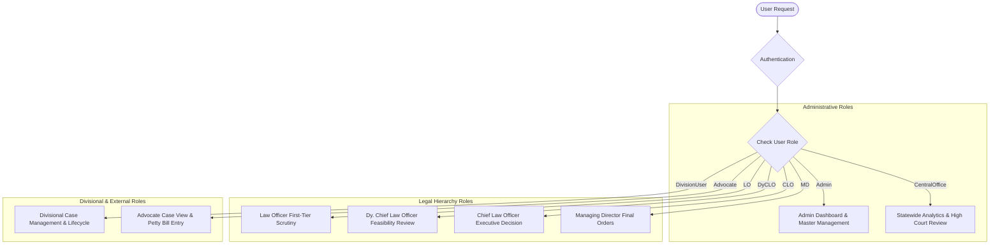

# Software Requirements Specification (SRS)
## Law Project — Enterprise Legal Case Management System

> **Platform Version**: ASP.NET Core 9.0 (C# 13) | **Persistence**: Microsoft SQL Server  
> **Target Environment**: Windows Server 2022 / IIS 10.0 | **Microservice**: NapixEcourtsApi  
> **Security Baseline**: PBKDF2 Password Hashing, Role-Based Access Control (8 Roles), CSRF Anti-Forgery Protection

---

## 1. Introduction

### 1.1 Purpose
This document specifies the software requirements for the enterprise **Case Management System (Law Project)**. The platform provides end-to-end legal lifecycle tracking, advocate entrustment, fee auditing, automated SMS notifications, artificial intelligence legal research, and bidirectional court record synchronization via the **NIC e-Courts NAPIX Gateway**.

### 1.2 Document Conventions & Definitions
- **MVC**: Motor Vehicle Claims
- **MACT**: Motor Accident Claims Tribunal
- **EP**: Execution Petition
- **MFA**: Miscellaneous First Appeal (High Court)
- **WP / WA**: Writ Petition / Writ Appeal (High Court)
- **SLP**: Special Leave Petition (Supreme Court of India)
- **CNR**: Case Number Record (16-character unique identifier for Indian court cases)
- **NAPIX**: National API Exchange Gateway (National Informatics Centre - NIC)
- **RAG**: Retrieval-Augmented Generation (Nyaya Patha AI Engine)
- **LO / Dy. CLO / CLO / MD**: Law Officer / Deputy Chief Law Officer / Chief Law Officer / Managing Director

### 1.3 Intended Audience
- **Software Engineers & Architects**: System design, data contracts, and implementation blueprints.
- **QA & Test Automation Engineers**: Validation of 284 unit and integration test suites.
- **System Administrators & DevOps**: IIS deployment, Ollama service configuration, and database maintenance.
- **Corporate Legal Officers**: Verification of compliance with NWKRTC and government legal guidelines.

### 1.4 Product Scope
The system manages:
1. **Motor Vehicle Accident Claims (MVC/MACT)**: Accident details, witness tracking, compensation awards, High Court MFA appeals, Supreme Court SLPs, and award Execution Petitions.
2. **Labour Disputes & Service Matters**: Industrial Disputes (ID), Section 33-C(2) LCAs, High Court Writ Petitions, and disciplinary actions.
3. **Arising Applications**: Monetary computation claims cross-referenced to parent labour disputes, itemized payment installment ledgers, multi-tier legal opinions, and official A4 printable case dossiers.
4. **Payment of Gratuity Act Claims**: Controlling Authority (CA) and Appellate Authority (AA) tracking, automated 10% statutory delayed interest computations.
5. **Other Courts**: Civil Suits, Revenue Courts, Consumer Forums, and Commercial Arbitration.
6. **Petty Bills & Advocate Fees**: Previous payment deduplication, fee disincentives, and multi-tier approval vouchers.
7. **Real-Time e-Courts Sync**: Bidirectional NAPIX integration with automated 16-digit CNR auto-linking, court hall resolution, and cause list scraping.
8. **Nyaya Patha AI**: Search-first RAG legal assistant, hybrid BM25 + dense vector search, document OCR extraction, and conflict detection.

---

## 2. Overall Description

### 2.1 Operating Environment
- **Web Application**: ASP.NET Core 9.0 MVC running under IIS 10.0 (Windows Server 2019/2022).
- **Database Server**: Microsoft SQL Server 2019+ (83 tables, stored procedures, dynamic startup migrator).
- **AI Engine**: Local on-premises **Ollama** running `qwen2.5:7b-instruct-q4_K_M` (`http://127.0.0.1:11434`).
- **External Gateways**: NIC e-Courts NAPIX Gateway v1.3, Karnataka Mobile-1 SMS Gateway, TR-18 Accident Portal.

### 2.2 System Architecture & User Roles

### 2.3 User Classes & Permissions Matrix

| Role | Scope | Permitted Operations |
| :--- | :--- | :--- |
| **Admin** | System-wide | User management, password resets, Master directories CRUD, system-wide audit inspection. |
| **DivisionUser** | Division-scoped | Case creation, hearing schedule updates, witness tracking, disposal marking for assigned `DivisionID`. |
| **CentralOffice** | Corporate-wide | Read-only statewide cross-divisional lookup, High Court/Supreme Court appeal processing, MIS reports. |
| **Advocate** | Entrusted Cases | Read-only view of assigned cases, upcoming hearing dates, petty bill voucher submission. |
| **Law Officer (LO)** | Division/CO | First-tier legal scrutiny, settlement recommendations, initial opinion recording. |
| **Dy. Chief Law Officer (Dy. CLO)** | Central Office | Second-tier legal analysis, appeal feasibility review, fee voucher endorsement. |
| **Chief Law Officer (CLO)** | Central Office | Legal policy enforcement, sanctioning High Court appeals, approval of settlement terms. |
| **Managing Director (MD)** | Corporate-wide | Final executive authority for high-value back-wages, Supreme Court SLP sanctions. |

---

## 3. Detailed Functional Requirements

### 3.1 Authentication & Security (SEC)
- **SEC-01**: Passwords must be hashed using cryptographic PBKDF2 with HMAC-SHA256 and unique per-user salts.
- **SEC-02**: All state-changing endpoints must enforce Anti-Forgery Token (`RequestVerificationToken`) validation.
- **SEC-03**: Cross-division tampering is prohibited via `DivisionControllerReadOnlyFilter`.
- **SEC-04**: Direct string interpolation in SQL queries is prohibited; all DAL repositories must use parameterized queries.
- **SEC-05**: File uploads are restricted to `.pdf`, `.jpg`, `.jpeg`, `.png` under a 50 MB threshold.

### 3.2 Motor Vehicle Claims (MVC)
- **MVC-01**: Capture complete accident profile, driver token, vehicle registration, and tribunal details.
- **MVC-02**: Record PW/RW witnesses, adverse depositions, and medical evidence documents.
- **MVC-03**: Support linking High Court MFA appeals with stay order expiration tracking.
- **MVC-04**: Support linking award Execution Petitions (EP) with court attachment notice tracking.

### 3.3 Labour Disputes & Arising Applications (LAB)
- **LAB-01**: Maintain Industrial Disputes (ID) and Section 33-C(2) LCAs linked to depot allocations.
- **LAB-02**: Enable cross-referencing Arising Applications to primary dispute IDs (e.g. KID/ID records).
- **LAB-03**: Maintain itemized payment installment ledgers for back-wages and compute remaining balances.
- **LAB-04**: Enforce multi-tier approval recording (Panel Advocate $\to$ LO $\to$ Dy. CLO $\to$ CLO $\to$ MD $\to$ DC).
- **LAB-05**: Generate official A4 printable case dossiers with corporation letterhead and 3-tier attestation blocks.

### 3.4 Payment of Gratuity Act (GRA)
- **GRA-01**: Record Controlling Authority (CA) claims and calculate statutory delayed interest at 10% per annum.
- **GRA-02**: Track Appellate Authority (AA) appeals and mandatory 100% pre-appeal statutory deposits.

### 3.5 e-Courts NAPIX Gateway Integration (ECO)
- **ECO-01**: Auto-discover 16-digit CNR from case type, case number, and registration year.
- **ECO-02**: Encrypt query parameters via AES-128-CBC and sign with HMAC-SHA256 request tokens.
- **ECO-03**: Automatically resolve Court Hall Numbers from business proceeding records.
- **ECO-04**: Provide server-side paginated `/ECourts/MyCases` with division filters and live status chips.
- **ECO-05**: Enforce hourly quota budgets of 1,000 calls per module to prevent IP bans.

### 3.6 Nyaya Patha AI Assistant (AI)
- **AI-01**: Execute Search-First RAG pipeline querying SQL precedent databases before LLM generation.
- **AI-02**: Run locally on-premises via Ollama Qwen2.5:7b-instruct to maintain absolute data sovereignty.
- **AI-03**: Provide automated petty bill duplicate detection and legal conflict analysis.
- **AI-04**: Provide an instant global Kill Switch to disable AI features dynamically without application restart.

### 3.7 Automated Background Services (BKG)
- **BKG-01**: Daily automated execution of `NotificationBackgroundService` to dispatch SMS hearing reminders (1-day, 3-day, 7-day).
- **BKG-02**: Hourly background execution of `NapixBackgroundSyncService` for active case synchronization within quota limits.

---

## 4. Verification & Quality Assurance

- **Test Suite**: 284 automated unit and integration tests across 17 test suites in [`MVCCaseManagement.Tests`](file:///c:/Users/adts-/Desktop/Law%20Project/Law%20Project/MVCCaseManagement.Tests).
- **Coverage**: Cryptographic signing, token caching, RAG retrieval factuality, 10% interest calculations, and SSRF prevention.
