# 🏗️ Law Project — System Architecture Guide

> **Enterprise Legal Management Monorepo**  
> Technical Architecture, Tier Breakdown, Request Lifecycles, Service Layers, and Data Storage Design.

---

## 📌 1. High-Level Architecture Overview

The **Law Project** is an enterprise-grade legal management platform engineered on **ASP.NET Core 9.0 MVC**, **Microsoft SQL Server**, and modern **Bootstrap 5 / Razor** user interfaces. It automates legal case lifecycle tracking, legal opinion workflows, advocate fee vetting, automated SMS hearing notifications, and real-time status synchronization with Indian courts via the **NIC e-Courts NAPIX API Gateway**.

```mermaid
graph TD
    subgraph ClientTier [Client & Presentation Layer]
        Browser[Modern Web Browser]
        UI[Responsive Bootstrap 5 + Razor UI]
        Browser <--> UI
    end

    subgraph SecurityMiddleware [ASP.NET Core 9.0 Middleware Pipeline]
        Correlation[CorrelationIdMiddleware]
        StaticFiles[Static File Provider /uploads]
        Routing[Routing & HTTPS Redirection]
        AuthCookie[Cookie Authentication & Claims Authorization]
        AntiCsrf[Global AntiForgeryToken Validation]
        ReadOnlyFilter[DivisionControllerReadOnlyFilter]
    end

    subgraph ControllersLayer [MVC Controller Tier - 19 Controllers]
        AccountCtrl[AccountController]
        CaseCtrl[CaseController]
        LabourCtrl[LabourController]
        GratuityCtrl[GratuityController]
        AppealCtrl[AppealController]
        EPCtrl[EPController & LabourEPController]
        ECourtsCtrl[ECourtsController]
        NyayaPathaCtrl[NyayaPathaController]
        ReportCtrl[ReportController]
        MasterCtrl[MasterController]
        AuditCtrl[AuditController & ActivityLogController]
        ApiDashCtrl[ApiDashboardController]
    end

    subgraph ServiceLayer [Business & AI Service Layer]
        AI_Engine[Nyaya Patha AI Engine - 34 Services]
        Ollama[Local Ollama / Qwen2.5:7b LLM]
        ECourts_Service[ECourtsNapixService & SyncEngine]
        SMS_Service[SMSService Mobile-1 Gateway]
        TR18_Service[TR18Service Accident Sync]
    end

    subgraph BackgroundServices [Hosted Background Services]
        NapixSyncWorker[NapixBackgroundSyncService]
        SMSNotificationWorker[NotificationBackgroundService]
    end

    subgraph DALLayer [Data Access Layer - 32 Repositories]
        DBHelper[DBHelper - SqlConnection Factory]
        DBMigrator[DBMigration & DatabaseMigrationRunner]
        CaseRepo[CaseRepository]
        LabourRepo[LabourRepository & ArisingAppRepo]
        GratuityRepo[GratuityRepository]
        AppealRepo[AppealRepository]
        ECourtsRepo[ECourtsRepository & QuotaRepo]
        MasterRepo[MasterRepository]
    end

    subgraph DatabaseLayer [Persistence Layer - Microsoft SQL Server]
        AdminLawDB[(Admin_Law / MVCCaseDB - 83 Tables)]
        TablesCases[tbl_MVC_Cases, tbl_Labour_Cases, tbl_Gra_Cases]
        TablesAppeals[tbl_Appeal_Details, tbl_Labour_EP_Details]
        TablesAI[tbl_NyayaPatha_Audit, tbl_Legal_Precedents]
        TablesECourts[tbl_ECourts_Cases, tbl_Napix_Api_Quota]
        TablesUsers[tbl_Users, tbl_Role_Master, tbl_Division_Master]
    end

    UI --> Correlation
    Correlation --> StaticFiles
    StaticFiles --> Routing
    Routing --> AuthCookie
    AuthCookie --> AntiCsrf
    AntiCsrf --> ReadOnlyFilter
    ReadOnlyFilter --> ControllersLayer

    ControllersLayer --> ServiceLayer
    ControllersLayer --> DALLayer
    BackgroundServices --> DALLayer
    BackgroundServices --> ServiceLayer

    AI_Engine <--> Ollama
    ServiceLayer --> DALLayer
    DALLayer --> DatabaseLayer
```



---

## 🏛️ 2. Monorepo Structure & Project Topology

The monorepo contains the core web portal, microservice, test harness, documentation hub, and deployment scripts:

```
Law Project/
├── .vscode/                               # Workspace configuration
├── docs/                                  # Master documentation hub
│   ├── INDEX.md                           # Documentation catalog
│   ├── SYSTEM_ARCHITECTURE.md             # This document
│   ├── MODULES_AND_FEATURES_GUIDE.md      # Functional domain walkthrough
│   ├── ECOURTS_INTEGRATION_GUIDE.md       # NAPIX v1.3 gateway guide
│   ├── NYAYA_PATHA_PRODUCTION_DEPLOYMENT_PLAN.md # AI inference operations
│   ├── PETTY_BILL_PREVIOUS_PAYMENTS_GUIDE.md     # Legal fee audit guide
│   ├── PUBLISHING_GUIDE.md                # Deployment and IIS operations
│   ├── PROJECT_RULES.md                   # Engineering standards & guidelines
│   ├── DATABASE_SCHEMA.md                 # Database schema & table dictionary
│   └── references/                        # Official NIC NAPIX OpenAPI specs (PDF)
├── Law Project/
│   ├── CaseManagement/                    # Main ASP.NET Core 9.0 Web Application
│   │   ├── Common/                        # Cross-cutting middlewares, helpers, options
│   │   ├── Controllers/                   # 19 MVC Action Controllers
│   │   ├── DAL/                           # 32 Repositories + Schema Migrators
│   │   ├── Models/                        # Domain models and ViewModels
│   │   ├── Services/                      # Background workers, AI engine, SMS/TR18
│   │   │   └── AI/                        # 34 Nyaya Patha AI research components
│   │   ├── SQL/                           # Master schema and seed scripts
│   │   ├── Utils/                         # NAPIX crypto, security, network utilities
│   │   ├── Views/                         # Razor UI views (19 functional areas)
│   │   ├── wwwroot/                       # Static assets (Bootstrap 5, JS, CSS)
│   │   ├── Program.cs                     # Startup configuration & DI container
│   │   ├── appsettings.json               # Environment configuration
│   │   └── web.config                     # Hardened IIS hosting configuration
│   └── MVCCaseManagement.Tests/           # Automated Test Suite (284 tests across 17 test suites)
├── NapixEcourtsApi/                       # Microservice handling AES/HMAC eCourts proxying
├── publish/                               # Deployment artifacts mirror
├── Publish_Output/                        # Compiled production binaries for IIS
├── scripts/                               # Maintenance & database migration utilities
├── publish.bat                            # Master single-click Windows publish script
├── publish.ps1                            # Master PowerShell release build pipeline
└── LawProject.sln                         # Visual Studio Unified Solution file
```

---

## ⚙️ 3. ASP.NET Core 9.0 Pipeline & Middleware

The request processing pipeline is configured in [`Program.cs`](file:///c:/Users/adts-/Desktop/Law%20Project/Law%20Project/CaseManagement/Program.cs):

### 3.1 Middleware Order
1. **CorrelationIdMiddleware**: Generates and attaches a unique `X-Correlation-ID` GUID to each request for distributed tracing across logs.
2. **ExceptionHandler / HSTS**: Production error interception and HTTP Strict Transport Security enforcement.
3. **Static Files & File Vault**: Serves static CSS/JS from `wwwroot` and authenticated documents from physical upload directories.
4. **Cookie Authentication**: Inspects `CookieAuthenticationDefaults.AuthenticationScheme`, populates `ClaimsPrincipal` with user identity, `RoleID`, and `DivisionID`.
5. **Session Middleware**: Handles user session timeouts and state caching (30 minutes default).
6. **Global Anti-Forgery Token Validation**: Automatically validates `RequestVerificationToken` headers on state-changing requests (`POST`, `PUT`, `DELETE`).
7. **DivisionControllerReadOnlyFilter**: Enforces divisional boundaries, preventing cross-division unauthorized modifications.

---

## 🎛️ 4. MVC Controllers Architecture (19 Controllers)

The presentation and API tier is handled by 19 specialized controllers:

| Controller | Source File | Responsibilities |
| :--- | :--- | :--- |
| **AccountController** | [`AccountController.cs`](file:///c:/Users/adts-/Desktop/Law%20Project/Law%20Project/CaseManagement/Controllers/AccountController.cs) | Authentication, login/logout, password change with PBKDF2 hashing, user profile management. |
| **ActivityLogController** | [`ActivityLogController.cs`](file:///c:/Users/adts-/Desktop/Law%20Project/Law%20Project/CaseManagement/Controllers/ActivityLogController.cs) | Centralized audit log inspection, filtering by user, division, and timestamp. |
| **ApiDashboardController** | [`ApiDashboardController.cs`](file:///c:/Users/adts-/Desktop/Law%20Project/Law%20Project/CaseManagement/Controllers/ApiDashboardController.cs) | Live telemetry for external APIs (eCourts NAPIX, TR18, SMS Mobile-1, AI providers). |
| **AppealController** | [`AppealController.cs`](file:///c:/Users/adts-/Desktop/Law%20Project/Law%20Project/CaseManagement/Controllers/AppealController.cs) | High Court (MFA/WP/WA) and Supreme Court (SLP) appeals lifecycle, stay orders, and compensation deposits. |
| **AuditController** | [`AuditController.cs`](file:///c:/Users/adts-/Desktop/Law%20Project/Law%20Project/CaseManagement/Controllers/AuditController.cs) | Sensitive operations tracking, tamper-evident record mutation history. |
| **CaseController** | [`CaseController.cs`](file:///c:/Users/adts-/Desktop/Law%20Project/Law%20Project/CaseManagement/Controllers/CaseController.cs) | Core MVC / MACT case registration, PW/RW witness records, tribunal awards, deposits, inter-division transfers. |
| **DashboardController** | [`DashboardController.cs`](file:///c:/Users/adts-/Desktop/Law%20Project/Law%20Project/CaseManagement/Controllers/DashboardController.cs) | Statewide and divisional KPI overview, pending vs disposed summaries, financial exposure. |
| **ECourtsController** | [`ECourtsController.cs`](file:///c:/Users/adts-/Desktop/Law%20Project/Law%20Project/CaseManagement/Controllers/ECourtsController.cs) | NIC NAPIX v1.3 integration, CNR resolution, High Court & District Court case lookup, MyCases server-side pagination, Hall resolution. |
| **EPController** | [`EPController.cs`](file:///c:/Users/adts-/Desktop/Law%20Project/Law%20Project/CaseManagement/Controllers/EPController.cs) | Motor Vehicle Claims Execution Petitions (EP), attachment warrants, bank deposits. |
| **GratuityController** | [`GratuityController.cs`](file:///c:/Users/adts-/Desktop/Law%20Project/Law%20Project/CaseManagement/Controllers/GratuityController.cs) | Payment of Gratuity Act claims, Controlling & Appellate Authority cases, 10% p.a. interest calculation, petty bills. |
| **HomeController** | [`HomeController.cs`](file:///c:/Users/adts-/Desktop/Law%20Project/Law%20Project/CaseManagement/Controllers/HomeController.cs) | System landing page, navigation hub, session status. |
| **JudgementController** | [`JudgementController.cs`](file:///c:/Users/adts-/Desktop/Law%20Project/Law%20Project/CaseManagement/Controllers/JudgementController.cs) | Repository of legal precedents, judgment tagging, and full-text reference linking. |
| **LabourController** | [`LabourController.cs`](file:///c:/Users/adts-/Desktop/Law%20Project/Law%20Project/CaseManagement/Controllers/LabourController.cs) | Industrial Disputes, Section 33-C(2) Arising Applications, Parent case linking, Multi-tier legal opinions, A4 printable dossier. |
| **LabourEPController** | [`LabourEPController.cs`](file:///c:/Users/adts-/Desktop/Law%20Project/Law%20Project/CaseManagement/Controllers/LabourEPController.cs) | Labour Court Execution Petitions for reinstatement and back-wages recovery. |
| **MasterController** | [`MasterController.cs`](file:///c:/Users/adts-/Desktop/Law%20Project/Law%20Project/CaseManagement/Controllers/MasterController.cs) | Master directories: Divisions, Depots, Courts, MACT Tribunals, Advocates, Case Statuses, System Users. |
| **NotificationController**| [`NotificationController.cs`](file:///c:/Users/adts-/Desktop/Law%20Project/Law%20Project/CaseManagement/Controllers/NotificationController.cs) | In-app hearing reminder center, stay expiry countdowns. |
| **NyayaPathaController** | [`NyayaPathaController.cs`](file:///c:/Users/adts-/Desktop/Law%20Project/Law%20Project/CaseManagement/Controllers/NyayaPathaController.cs) | AI legal research assistant, RAG queries, document OCR extraction, petty bill compliance checks. |
| **ReportController** | [`ReportController.cs`](file:///c:/Users/adts-/Desktop/Law%20Project/Law%20Project/CaseManagement/Controllers/ReportController.cs) | Division & Central Office Monthly Legal Statements, Pending Reconciliation, Excel/PDF exports. |
| **UploadsController** | [`UploadsController.cs`](file:///c:/Users/adts-/Desktop/Law%20Project/Law%20Project/CaseManagement/Controllers/UploadsController.cs) | Secure authenticated PDF streaming, file upload MIME validation, path traversal defense. |

---

## 🤖 5. Nyaya Patha AI Engine (34 Services)

The AI engine in `Services/AI/` implements a strict **Search-First RAG Pipeline**:

```
[ User Legal Query ]
        │
        ▼
[ QueryRouterService ] ───▶ [ DocumentTextExtractor (OCR/PDF) ]
        │
        ▼
[ DynamicDatabaseRetrievalService ] ───▶ [ SQL Precedents & Case DB ]
        │
        ▼
[ DocumentSearchService ] ───▶ [ BM25 + Ollama Dense Vector Embeddings ]
        │
        ▼
[ CaseContextBuilder ] ───▶ [ Legal Context Assembly & Token Windowing ]
        │
        ▼
[ OllamaLLMProvider ] ───▶ [ Local Qwen2.5:7b-instruct Inference ]
        │
        ▼
[ PostGenerationVerifier ] ───▶ [ Factuality & Citation Verification ]
        │
        ▼
[ ConflictDetectorService ] ───▶ [ Adverse Ruling & Precedent Conflict Flags ]
        │
        ▼
[ AIAuditService ] ───▶ [ Comprehensive Audit Log & Token Telemetry ]
        │
        ▼
[ Verified Legal Research Brief ]
```

### Key AI Subsystems:
- **`UnifiedLegalResearchService.cs`** (212 KB): Master orchestrator coordinating context retrieval, LLM inference, and verification.
- **`CaseContextBuilder.cs`** (193 KB): Ingests case facts, parent dispute records, and eCourts history into structured LLM prompts.
- **`OllamaLLMProvider.cs`**: Native HTTP client interfacing with Ollama (`http://127.0.0.1:11434`) running `qwen2.5:7b`.
- **`ConflictDetectorService.cs`**: Flags conflicting high court judgments or adverse rulings before presenting advice.
- **`PostGenerationVerifier.cs`**: Validates legal citations against the internal precedent database to prevent hallucinations.

---

## 💾 6. Data Access Layer (DAL) & Schema Migration (32 Repositories)

The persistence tier relies on high-performance ADO.NET and Dapper using parameterized queries:

### 6.1 Database Connection Management
- **`DBHelper.cs`**: Factory creating `SqlConnection` instances with connection pooling (`Max Pool Size=200`, `MultiSubnetFailover=True`, `ConnectRetryCount=3`).

### 6.2 Schema Bootstrapping & Automatic Migrations
- **`DatabaseMigrationRunner.cs` & `DBMigration.cs`**: Executes on application startup, inspecting table definitions, column types, and indexes. It automatically applies incremental schema updates without requiring downtime.
- **Master SQL Baseline**: [`00_Master_Full_Database_Schema_And_Seed.sql`](file:///c:/Users/adts-/Desktop/Law%20Project/Law%20Project/CaseManagement/SQL/00_Master_Full_Database_Schema_And_Seed.sql) defines all 83 core tables, primary/foreign keys, stored procedures, and seed roles.

---

## 🔒 7. Role-Based Access Control (RBAC) Matrix

The system implements 8 distinct user roles:

| Role Name | Scope | Permissions & Functional Boundaries |
| :--- | :--- | :--- |
| **Admin** | System-wide | Full system administration, user provisioning, master directory CRUD, system-wide audit reviews. |
| **DivisionUser** | Divisional | Case registration, hearing schedule updates, witness tracking, disposal marking for their assigned `DivisionID`. |
| **CentralOffice** | Corporate-wide | Cross-divisional read-only access, High Court/Supreme Court appeal processing, executive reporting. |
| **Advocate** | Assigned Cases | Read-only view of entrusted cases, hearing schedule calendar, petty bill submission. |
| **Law Officer (LO)** | Divisional/CO | First-tier legal evaluation, opinion recording, award settlement recommendations. |
| **Dy. Chief Law Officer (Dy. CLO)** | Central Office | Second-tier legal scrutiny, appeal feasibility assessment, fee voucher endorsement. |
| **Chief Law Officer (CLO)** | Central Office | Executive legal decisions, sanctioning High Court appeals, approval of settlement terms. |
| **Managing Director (MD)** | Corporate-wide | Final executive authority for high-value back-wages, Supreme Court SLP sanctions, and policy exceptions. |

---

## ⏰ 8. Hosted Background Services

The application hosts two 24/7 background worker processes:

1. **`NotificationBackgroundService.cs`**:
   - Executes daily automated batch routines.
   - Computes upcoming court hearings (1-day, 3-day, and 7-day windows).
   - Generates SMS notifications dispatched via Karnataka Mobile-1 Gateway (`SMSService`).
   - Detects expiring stay orders (15-day warning) and High Court limitation deadlines (90-day warning).

2. **`NapixBackgroundSyncService.cs`**:
   - Manages hourly API quota budgets (`NapixQuotaService`).
   - Dispatches background sync jobs to query NIC NAPIX e-Courts for active case updates.
   - Synchronizes next hearing dates, interim orders, and bench details.
